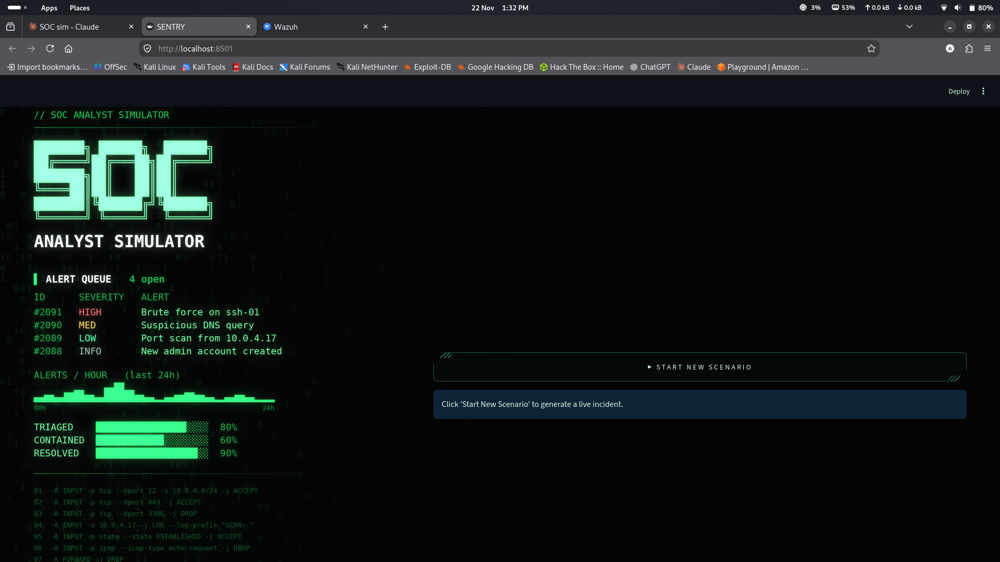
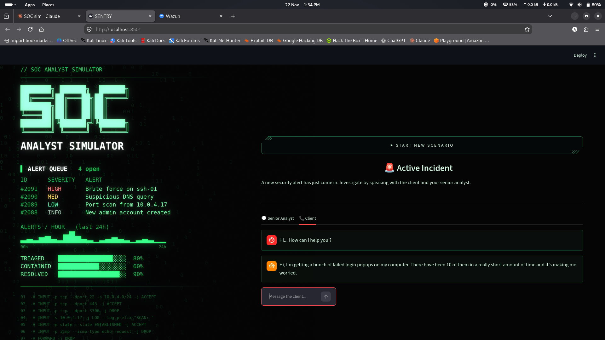
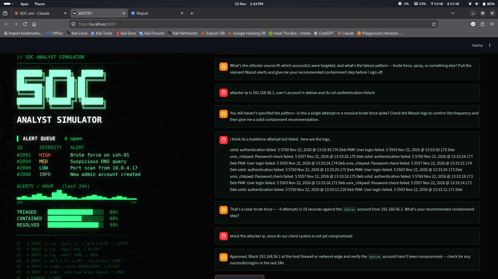
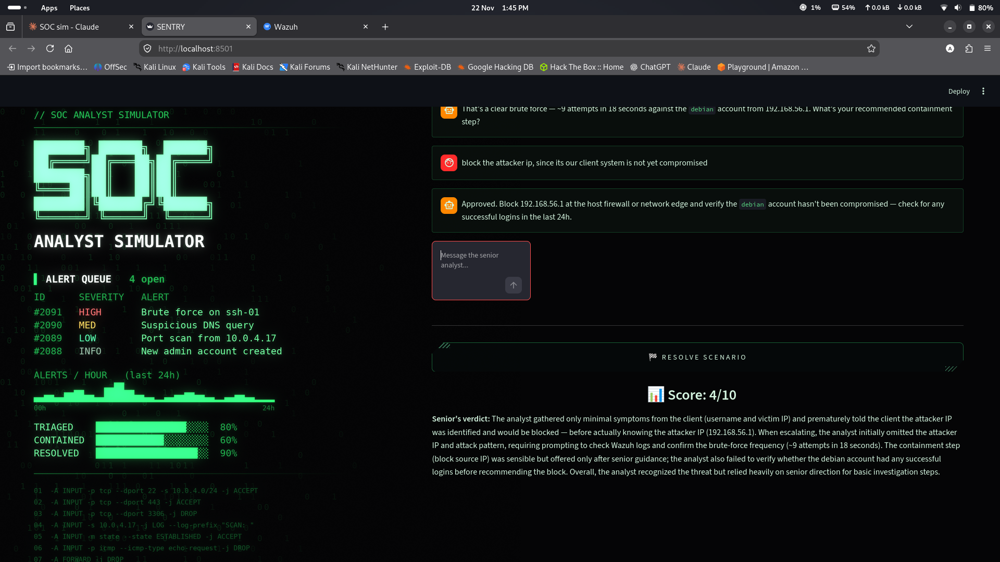

# SENTRY — SOC Analyst Training Simulator

An interactive training application that simulates a real Security Operations
Center (SOC) environment. The user plays the role of a Tier-1 analyst
responding to live security incidents — investigating real alerts, talking to
an AI-driven "client," escalating to an AI-driven senior analyst, and getting
scored on their handling of each incident.

Every incident in this simulator is based on **real security telemetry**, not
scripted data: the app triggers an actual attack against a lab VM, waits for
Wazuh (an open-source SIEM/XDR platform) to detect and log it, then pulls the
real resulting alert to drive the scenario.

## Why this project

Most portfolio security projects use static sample data or canned scenarios.
This one doesn't — every session is backed by a genuine attack against a real
monitored machine, giving the user (and anyone reviewing this project) a true
end-to-end demonstration of the detection → investigation → response pipeline
a real SOC analyst works through daily.

## Architecture

```
┌─────────────┐      triggers      ┌──────────────┐
│   SENTRY    │ ─────attack──────▶ │  Debian VM   │
│  (Streamlit │                    │ (SSH target) │
│     app)    │ ◀───Wazuh alert─── │              │
└─────────────┘                    └──────────────┘
       │
       │ chat (client + senior personas)
       ▼
┌─────────────┐
│  OpenRouter │
│   LLM API   │
└─────────────┘
```

- **Kali Linux** hosts the Wazuh manager + indexer and runs the Streamlit app
- **Debian 13 VM** (host-only network) is the monitored target, running a Wazuh agent
- **Wazuh** detects real SSH brute-force attempts and surfaces them as structured alerts
- **OpenRouter** (LLM API) powers two in-character personas: a non-technical "client" reporting the incident, and a senior analyst who reviews the investigation

## Features

- **Live, randomized attack generation** — each session runs one of three real scenarios against the target VM:
  - A **false positive** (a single mistyped login — most incidents in a real SOC are noise, not attacks)
  - A **failed brute-force attempt** (multiple failed logins, no compromise)
  - A **successful compromise** (failed attempts followed by a real successful login — the most serious case)
- **No data handed to the user up front** — the alert card only shows that *something* happened. The user must investigate through conversation to learn what's actually going on, just like in a real SOC.
- **Two grounded AI personas**, each with a fixed set of facts they cannot contradict, preventing the common LLM failure mode of inventing details or breaking character under pressure
- **Fact-anchored scoring** — after resolving an incident, the senior analyst persona scores the user (1–10) and gives a verdict based strictly on the actual conversation transcript, with explicit guardrails against the AI hallucinating critique of things that never happened
- **Custom terminal/HUD-themed UI** built with Streamlit and custom CSS

## Tech stack

- **Python 3 / Streamlit** — application and UI
- **Wazuh** (SIEM/XDR) — detection engine, running the manager + indexer on Kali
- **OpenSearch** — Wazuh's underlying alert database, queried directly for real-time scenario data
- **OpenRouter API** — LLM access for the client/senior personas (free-tier models, with automatic fallback across models for reliability)
- **VirtualBox** — lab virtualization (Kali manager + Debian target, host-only network)

## How it works

1. User clicks **Start New Scenario**
2. The app runs a real SSH login attempt (or sequence of attempts) against the target VM using `sshpass`
3. After a short delay (to allow Wazuh to process and index the event), the app queries Wazuh's OpenSearch backend for the resulting alert
4. The alert data is used to build the scenario context — fed into the system prompts for both AI personas
5. The user investigates by chatting with the **client** (who describes symptoms in plain language) and the **senior analyst** (who expects technical detail and a containment recommendation)
6. The user clicks **Resolve Scenario** in the Senior Analyst tab — the full conversation is sent back to the AI, which scores the response and gives a verdict grounded strictly in what was actually said

## Setup

1. Set up a Wazuh manager (on Kali or any Linux host) and a monitored agent VM (Debian recommended) on the same host-only network, with SSH enabled on the target.
2. Clone this repo and set up the Python environment:
   ```bash
   python3 -m venv venv
   source venv/bin/activate
   pip install -r requirements.txt
   ```
3. Create a `.env` file with:

WAZUH_INDEXER_URL=https://localhost:9200
WAZUH_INDEXER_USER=admin
WAZUH_INDEXER_PASS=<your indexer password>
OPENROUTER_API_KEY=<your OpenRouter key>

4. Update `TARGET_IP` in `app/main.py` to match your target VM's IP.
5. Run:
   ```bash
   streamlit run app/main.py
   ```

## Known limitations

- A successful-compromise scenario was originally attempted against a Windows VM via RDP, but was abandoned due to Windows's single-session RDP limit causing unreliable, non-scriptable "session bump" prompts. Switching the target to a Debian VM with SSH resolved this cleanly.
- SMB-based attack scenarios were considered but are currently disabled, since SMB (port 445) was blocked by the target's firewall in this lab setup.
- Free-tier LLM models occasionally rate-limit or vary in response quality; the app includes a fallback list of models to mitigate this.

## Screenshots

**Start screen**


**Investigating via the client**


**Reporting to the senior analyst**


**Scenario resolved — scored and reviewed**


## Author

Alen Madhu — built as a hands-on project to develop practical SOC analyst skills, combining real SIEM operation with applied LLM integration.

